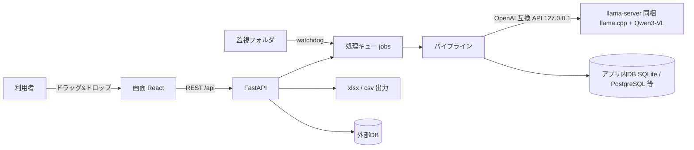

# 設計

## 全体

- **アプリ版**(`eagle desktop`): API を 127.0.0.1 で起動し、pywebview(WebView2)の専用ウィンドウで画面を開く。認証なし。
- **Webアプリ版**(`eagle server`): 同じ API を LAN へ公開し、複数人がブラウザから使う。ログイン必須・権限あり。
- どちらも同じコード・同じ DB スキーマ。推論は同梱の llama-server(または別に用意した OpenAI 互換サーバー / Ollama)。

## 1書類の処理(`eagle/pipeline/processor.py`)

1. **読込**(`loader.py`): PDF を画像化(既定 300dpi)し、テキスト層・単語座標も取る。画像・TIFF・メール(添付+本文)・Excel/CSV/テキストに対応。スキャン画像は傾きを補正(`imaging.py`)。
2. **対象外の判定**(`doc_type.py`): ファイル名・テキスト層の表題で「現品票・納品書・請求書」等を除外。注文系の語を同時に含む表題は注文書として扱う。
3. **テンプレート判定**(`templates.py`): 本文・ファイル名・(VLM 読取後は)社名でテンプレートを選ぶ。長い語は1文字の誤読まで許容。
4. **書類全体の読取**: 表題・登場する会社(役割付き)・注文番号・日付・届け先・合計など。空返しは温度を上げて再試行。
5. **発注元の再読取**: 自社(宛先)しか読めなかった時、発注元だけを狙って読み直す。
6. **ROI 焦点読取**(`roi.py`): テンプレートの領域を切り出して精読(電子 PDF は文字情報を直接読む)。
7. **明細の読取**: ページごと(または ROI の明細範囲)。商品マスタが小さければ指示文に同梱し、型番の補正に使わせる。
8. **後処理**(`postprocess.py`): 集計行・控えページ・本文に無い送料行の除去、負値ガード、金額の補完と検算、型番の確定(`products.py`)、重複・異金額の警告。
9. **項目の確定**: 役割から発注元・納品先を決め、注文番号を検証(ジャンク除去・書式・テキスト層)、日付・数値を正規化。
10. **顧客照合**(`customers.py`): 顧客マスタから発注元・納品先のレコードを根拠点数で選ぶ。根拠不足なら空欄(人手)。
11. **テンプレートの既定値・固定値、学習補正**(`learning.py`)を適用し、要確認の有無で状態を決めて保存。

## データ

| テーブル | 内容 |
|---|---|
| documents | 書類。`header`(現在値)と `extracted_header`(エンジン出力。学習の比較元)を別に持つ |
| line_items | 明細。`extracted` にエンジン出力時点の値 |
| templates | 発行元ごとの判定キーワード・ROI・読取ヒント・既定値・固定値・書式 |
| field_defs | ユーザー定義の追加項目 |
| product_master / customer_master | 任意のマスタ |
| corrections | 学習した修正(値の置換・既定値・型番の読み替え) |
| jobs | 処理キュー(再起動しても未処理から再開) |
| users / sessions | サーバー版の利用者 |
| settings | 画面から変える設定(JSON) |
| db_targets | 外部DB連携先 |
| events | 操作・処理ログ |

原本・ページ画像・単語座標は `data/files/<uid>/` に保存する。

## VLM の呼び出し(`eagle/vlm/`)

- llama-server を `--host 127.0.0.1 --parallel 1` で起動し、OpenAI 互換 API で呼ぶ。Windows ではジョブオブジェクトに入れ、アプリが強制終了されても残らないようにしている。
- 出力は JSON スキーマで強制(llama.cpp の文法制約)。壊れた JSON も寛容に解釈する。
- 空返し(明細や会社が空)の時は温度を 0 → 0.3 → 0.6 と上げて再試行する。
